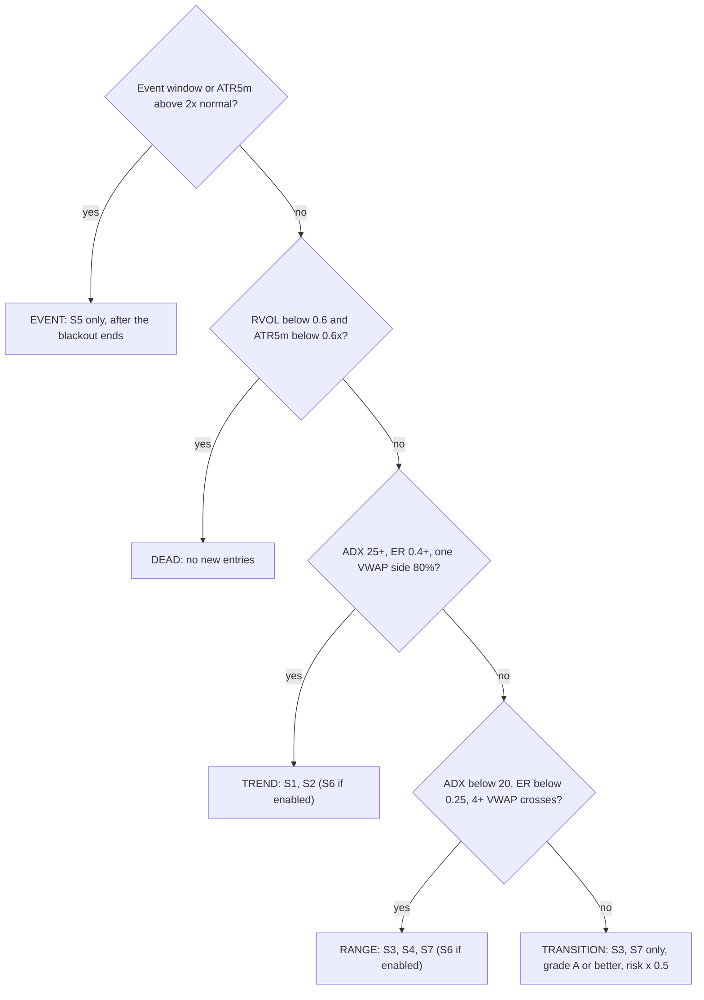

# Day Trading Advisor Rulebook

Version dt-rules-1.0 · 27 October 2026 · machine-readable values in [`config/day_trading_rules.json`](../config/day_trading_rules.json)

## 1. Purpose and how to use this rulebook

The advisor's default answer is NO TRADE: it only issues a signal when every rule below passes, and every signal must name the rule IDs that produced it. This turns the research brief into deterministic logic that n8n can execute and the Tally app can track.

**Why this posture.** The brief's evidence is blunt: in large retail datasets, more than eight in ten day traders lost money in a typical six-month period, and only about 5% had positive cumulative net returns. An edge has to survive spreads, commissions, slippage, tax and behaviour, so risk and cost rules sit above strategy rules.

**Scope (v1)**

- Intraday only: every position is flat before the instrument's session close. No overnight holds, no swing trades (those belong to the separate forex swing advisor).
- Advisory only: the advisor proposes; a human places the order. Auto-execution is out of scope until a strategy passes the full validation pipeline (section 14).
- Liquid instruments only: FX majors, major index CFDs or micro futures, large-cap equities (section 6).

**Design principles**

1. Code decides, the LLM explains. All prices, indicators, scores and sizes are computed in deterministic code. The language model may summarise, explain or veto a signal. It may never create, upgrade or resize one.
2. Fail closed. Missing data, an unknown regime or an ambiguous rule means no signal.
3. Every parameter in `{braces}` is a starting default to be tuned in backtesting and stored in config, never hard-coded.
4. Bar-close evaluation. Rules are evaluated on completed bars only (default 5-minute), which removes look-ahead bias and keeps n8n polling realistic.

**Rule ID prefixes and precedence** (when two rules conflict, the higher row wins)

| Prefix | Family | Section |
| --- | --- | --- |
| H | Hard rules (never overridden) | 2 |
| C | Circuit breakers and behaviour | 11 |
| K | Risk and position sizing | 9 |
| T | Session and time | 4 |
| U | Universe and cost filters | 6 |
| R | Market regime | 5 |
| S1–S7 | Strategy rules | 7 |
| G | Scoring and grading | 8 |
| M | Trade management | 10 |
| D, O, J, V | Data, output, journal, validation | 3, 12, 13, 14 |

## 2. Hard rules (H)

These 16 rules are checked before and after every strategy evaluation; if any fails, the output is NO\_TRADE with the failing rule ID as the reason code.

| ID | Rule | Reason code on fail |
| --- | --- | --- |
| H1 | A signal must contain instrument, direction, entry, stop, at least one target, position size, strategy ID and expiry time. | INCOMPLETE\_SIGNAL |
| H2 | The stop is defined before entry, is never widened, and may only move in the trade's favour. | STOP\_RULE |
| H3 | Risk per trade ≤ `{risk_pct}` of equity (default 0.25%–0.5%). Absolute ceiling 1%. | RISK\_CAP |
| H4 | Flat by session end: no position held past `{close − 10 min}` of the instrument's session; never through FX rollover. | SESSION\_END |
| H5 | No new entries inside a news blackout window (rule T6). | NEWS\_BLACKOUT |
| H6 | Round-trip cost (spread + commission + expected slippage) ≤ 10% of planned risk (cost ≤ 0.10R). Scalps: cost ≤ 20% of target. | COST\_TOO\_HIGH |
| H7 | Primary target ≥ 1.5R after costs (scalps ≥ 1.0R). | RR\_TOO\_LOW |
| H8 | Data freshness: latest completed bar ≤ 2 bar-intervals old and no gaps in the lookback window. | DATA\_STALE |
| H9 | If the daily loss limit (C1) is hit, the advisor is LOCKED until the next session. | LOCKED |
| H10 | One position per instrument. Total open risk ≤ 1% of equity. Positions in the same correlation group count as one position. | EXPOSURE\_CAP |
| H11 | No averaging down and no adding to a losing position. | NO\_AVERAGING |
| H12 | No number in a signal may originate from the LLM. The LLM can explain or veto, never create or upgrade. | LLM\_GUARD |
| H13 | Broker account must be with an FSCA-authorised provider (or equivalent top-tier regulator), flagged in config. | BROKER\_UNVERIFIED |
| H14 | Unknown regime, missing indicator or failed calculation → no trade. | FAIL\_CLOSED |
| H15 | A signal that cannot be written to the journal is not sent. | JOURNAL\_FAIL |
| H16 | Only strategies with status PAPER or LIVE may send alerts; RESEARCH strategies log shadow signals only. | STRATEGY\_NOT\_LIVE |

## 3. Data inputs and indicator definitions (D)

Every strategy reads from the same 18 computed inputs, so each indicator is defined once here and referenced by ID. Base data is 1-minute OHLCV, resampled to 5m (decision timeframe), 15m (bias), 1h and 1D (context).

| ID | Input | Definition | Default |
| --- | --- | --- | --- |
| D1 | Bars | OHLCV, completed bars only, exchange timestamps stored in UTC | 1m base; 5m decisions |
| D2 | Session VWAP | Σ(typical price × volume) ÷ Σ volume from the session anchor; typical price = (H + L + C) ÷ 3 | Anchor = instrument's primary open |
| D3 | VWAP bands | ±1σ and ±2σ volume-weighted standard deviation around VWAP | 1σ, 2σ |
| D4 | VWAP slope | (VWAP now − VWAP n bars ago) ÷ ATR5m | n = 6 bars |
| D5 | ATR / ADR | ATR(14) on 5m and 1D; ADR = mean daily high − low | ATR 14; ADR 20 days |
| D6 | EMAs | EMA 9 and 20 on 5m; EMA 20 and 50 on 15m; EMA 20 on 1D | as listed |
| D7 | ADX | ADX(14) on 5m, trend strength | 14 |
| D8 | Efficiency ratio | \|close now − close n ago\| ÷ Σ\|bar-to-bar change\| (1 = straight line, 0 = noise) | n = 20 |
| D9 | Relative volume | Volume in current time-of-day bucket ÷ average of the same bucket over 20 sessions | 20 sessions |
| D10 | Opening range | High and low of the first N minutes of the primary session; OR mid = average | N = 15 |
| D11 | Key levels | Prior day high/low/close, overnight or Asia high/low, weekly open, round numbers, levels with ≥ 2 touches in 5 sessions | touch tolerance 0.15 × ATR5m |
| D12 | Bollinger Bands | 20-period SMA ± 2 SD on 5m | 20, 2 |
| D13 | RSI | RSI(14) for momentum; RSI(2) for short-term exhaustion | 14 and 2 |
| D14 | Spread | Live spread and its median for the same time bucket; spread ratio = live ÷ median | 20-session median |
| D15 | Economic calendar | Event time (UTC), country/currency, impact (high/medium/low), consensus, actual | refresh every 15 min |
| D16 | Account state | Equity, open positions, realised R today and this week, consecutive losses, peak equity | real time |
| D17 | Swing points | Pivot high/low = bar with 2 lower highs (higher lows) on each side, 5m | 2 bars each side |
| D18 | Higher-timeframe bias | Bull if price > 1D EMA20 and 15m EMA20 > EMA50; bear if both opposite; else neutral | — |

**Candle definitions used by triggers**

- **Rejection candle:** wick on the rejected side ≥ 2 × body, close in the opposite third of the bar's range.
- **Engulfing:** body fully covers the prior bar's body, close beyond the prior bar's open.
- **Displacement candle:** range ≥ 1.5 × ATR5m with close in the outer 25% of its range.
- **Liquidity sweep:** wick trades beyond a key level by ≤ 0.3 × ATR5m, then the bar closes back on the original side.

**FX volume caveat.** Spot FX has no central volume. Use broker tick volume for D2, D3 and D9, or the matching futures contract's volume where the data source allows, and mark FX signals with `volume_source: tick` so their stats can be compared separately.

## 4. Session and time rules (T)

From Johannesburg the best day-trading windows are the London open (09:00–12:00 SAST) and the New York open into the London–NY overlap (roughly 14:30–18:30 SAST); most other hours are range-only or no-trade. South Africa has no daylight saving, but London and New York do, so their opens shift by an hour against SAST twice a year.

**T1.** Store every session time in its exchange's own time zone (`Europe/London`, `America/New_York`, `Asia/Tokyo`, `Africa/Johannesburg`) and convert at runtime with an IANA time-zone library. Never hard-code SAST offsets for foreign sessions.

| Window | Exchange local time | SAST, northern winter | SAST, northern summer | Advisor use |
| --- | --- | --- | --- | --- |
| Asia / Tokyo | 09:00–15:00 Tokyo | 02:00–08:00 | 02:00–08:00 | Mark Asia high/low; S4 only on JPY pairs |
| London open drive | 08:00–10:00 London | 10:00–12:00 | 09:00–11:00 | FX and EU index: S1, S2, S7 |
| JSE continuous trading | 09:00–16:50 SAST | 09:00–16:50 | 09:00–16:50 | SA40 and JSE equities |
| US data releases | 08:30 New York | 15:30 | 14:30 | Blackout (T6); S5 only |
| New York cash open | 09:30 New York | 16:30 | 15:30 | US indices: S1, S2, S7 |
| London–NY overlap | 08:00 NY – 16:00 London | 15:00–18:00 | 14:00–17:00 | Peak FX liquidity; S1, S6 |
| US midday | 11:30–13:30 New York | 18:30–20:30 | 17:30–19:30 | S3, S4 only; others need A+ |
| US final hour | 15:00–16:00 New York | 22:00–23:00 | 21:00–22:00 | S1 only; flat by 15:50 NY |
| FX rollover | 17:00 New York | 00:00 | 23:00 | Flat beforehand; spreads widen |

*Northern winter* = both London and New York on standard time (about November–March). In the transition weeks the two cities change on different dates. Example: in the week of 27 October 2026 London is already on GMT (London open 10:00 SAST) while New York stays on daylight time until 1 November (NY open 15:30 SAST). This is why T1 exists.

| ID | Rule | Default |
| --- | --- | --- |
| T2 | No market entries in the first `{2}` minutes after a primary open. ORB stop orders are placed only after the range completes. | 2 min |
| T3 | S2 (ORB) entries only until open + `{90}` minutes. | 90 min |
| T4 | S1 momentum entries in the first `{120}` minutes after an open and in the US final hour. | 120 min |
| T5 | During the US midday window, only S3/S4, or another strategy graded A+. | — |
| T6 | News blackout. High impact: no new entries from `{−15}` to `{+5}` minutes. Medium: `{−5}` to `{+2}`. Rate decisions: from −15 minutes until the press conference ends, for the affected currency and its indices. | −15/+5 |
| T7 | Last new entry `{60}` minutes before the instrument's session close; all positions flat by close − `{10}` minutes. | 60 / 10 |
| T8 | Friday: no new entries after 12:00 New York. Month-end, half-days and the day before a holiday: A+ only. | — |
| T9 | Public holiday in an instrument's home market → instrument disabled for the day. | — |
| T10 | Monday Asia open: no entries in the first 60 minutes (weekend gap risk). | 60 min |

## 5. Market regime classification and routing (R)

The regime decides which strategies may run: trend strategies fail in ranges and mean-reversion fails in trends, so the advisor classifies the market before it looks for any setup.



The checks run top to bottom on every completed 5m bar; anything that is neither clearly trending nor clearly ranging is TRANSITION, where size is halved.

| ID | Regime | Conditions |
| --- | --- | --- |
| R1 | EVENT | Inside a T6 blackout or an S5 window (T − 15 to T + 90 min), or ATR5m > 2 × its time-bucket average, or spread ratio > 2. |
| R2 | DEAD | RVOL < 0.6 and ATR5m < 0.6 × its time-bucket average. |
| R3 | TREND | ADX(14) ≥ 25, ER(20) ≥ 0.4, price on one side of VWAP for ≥ 80% of bars since the open, VWAP slope the same sign for 6 bars, RVOL ≥ 1.2. |
| R4 | RANGE | ADX(14) < 20, ER(20) < 0.25, VWAP crossed ≥ 4 times in the last 24 bars, session range ≤ 0.8 × ADR. |
| R5 | TRANSITION | Everything else. |
| R6 | OPENING | First 30 min after a primary open, before the checks have enough data. Only S2 (with its pre-filters) and S7 may run. |

**R7. Confidence** = how far the deciding conditions clear their thresholds, normalised to 0–1. A TREND or RANGE label with confidence < 0.5 is treated as TRANSITION.

**R8. Hysteresis.** TREND, RANGE and TRANSITION change only after 2 consecutive bars agree, which stops flip-flopping. EVENT and DEAD apply immediately.

**R9. Routing**

| Regime | Strategies allowed | Regime risk multiplier |
| --- | --- | --- |
| OPENING | S2, S7 | 1.0 |
| TREND | S1, S2 (until T3 cutoff), S6 if enabled | 1.0 |
| RANGE | S3, S4, S7, S6 if enabled | 1.0 |
| TRANSITION | S3 (ADX < 20), S7; grade A or better | 0.5 |
| EVENT | S5 | 1.0 (S5's own 0.5 applies) |
| DEAD | none | — |

## 6. Instrument eligibility and cost filters (U)

An instrument is scanned only if it is on the approved list and passes the liquidity, spread, volatility and cost checks at that moment; the brief's recommended start is one liquid index or FX major in its most liquid hours.

**U1. Approved universe (config list).** Start with Tier 1 only; add Tier 2 after 100 paper trades.

| Tier | Instruments | Primary session | Notes |
| --- | --- | --- | --- |
| 1 | EUR/USD, GBP/USD, USD/JPY | London open, overlap | Tightest FX spreads; tick-volume VWAP |
| 1 | US500 / NAS100 index CFD or MES / MNQ micro futures | New York open | Real volume on futures |
| 1 | GER40 index CFD | London open (Frankfurt cash 09:00 CET) | Strong opening-range behaviour |
| 2 | XAU/USD (gold) | London open, overlap | Volatile; risk multiplier 0.75 |
| 2 | SA40 (JSE Top 40) CFD, top-20 JSE stocks by daily value | JSE 09:00–16:50 SAST | Check spreads; thinner after 16:00 |
| 2 | USD/ZAR | London open, overlap | Wider spreads; cost filter usually decides |
| Excluded v1 | Exotic FX, small caps, crypto, options | — | Different microstructure or costs |

| ID | Rule | Default |
| --- | --- | --- |
| U2 | Equity liquidity: average daily traded value ≥ `{US$20m}` (US) or `{R100m}` (JSE); price ≥ `{US$5}`. | as listed |
| U3 | Spread ratio (D14) ≤ `{1.5}` and live spread ≤ `{10%}` of ATR5m. | 1.5 / 10% |
| U4 | Not dead: ATR5m ≥ `{0.6}` × its 20-session average for this time bucket and RVOL ≥ `{0.6}`. | 0.6 |
| U5 | Cost in R = (spread + 2 × commission + expected slippage) ÷ stop distance ≤ `{0.10}` (H6). | 0.10 |
| U6 | Equities need a catalyst for S1/S2: gap ≥ `{2%}`, or RVOL ≥ `{2}`, or company news today. | 2% / 2 |
| U7 | Exclude an instrument with earnings, ex-dividend, index rebalance or trading halt today, except for S5. | — |
| U8 | Correlation groups count as one position (H10): USD block (EUR/USD, GBP/USD, USD/JPY inverted, XAU/USD), US indices, EU indices, ZAR block (USD/ZAR, SA40). | max 1 per group |

Thresholds marked with braces are starting defaults; confirm them against your broker's actual spreads and commissions before paper trading.

## 7. Strategy rules (S1–S7)

Seven strategies cover the brief's six plus one addition (S7, failed-breakout reversal) that trades the main way ORB and momentum fail. Each is written for a long trade; shorts are the exact mirror. Every condition in a Setup row must be true on the same completed 5m bar.

### S1 — VWAP momentum continuation

| Field | Rule |
| --- | --- |
| Edge | Trapped counter-trend traders and late participants push an established intraday trend further. |
| Regimes | TREND only. |
| Window | Open + 5 min to open + 120 min (T4); US final hour. |
| Setup | Price above VWAP on ≥ 80% of the last 12 bars. VWAP slope (D4) ≥ +0.10. EMA9 > EMA20 on 5m. HTF bias (D18) bull or neutral. RVOL ≥ 1.5. Last two swing lows ascending. |
| Pullback | Retrace into the zone between VWAP and EMA20 (or a broken level), depth ≤ 61.8% of the last impulse, pullback volume below impulse volume, no 5m close below VWAP − 0.25 × ATR5m. |
| Trigger | A 5m bar in the zone closes above the prior bar's high, or prints a bullish engulfing / rejection candle, on volume ≥ its 20-bar average. |
| Entry | Buy stop 1 tick above the trigger bar's high; valid for 2 bars. |
| Stop | Below the pullback low − 0.1 × ATR5m. Stop distance must be 0.5–1.5 × ATR5m, otherwise skip. |
| Targets | T1 = 1.5R (close 50%). Runner trails under each new 5m swing low (M4). If the day's high is closer than 1.5R, skip unless the day's high is already broken. |
| Exit early | 5m close below VWAP, or two consecutive closes below EMA20. Time stop: not at +0.5R within 6 bars. |
| Cancel before fill | Close below VWAP; RVOL < 1.0; regime no longer TREND. |
| Avoid | Price beyond the +2σ VWAP band (over-extended), third or later leg of the move, a major level within 1R. |
| Limits | 2 attempts per instrument per session; the second needs grade A or better. |

### S2 — Opening-range breakout (ORB)

| Field | Rule |
| --- | --- |
| Edge | The session's first volatility expansion often sets the day's direction after an overnight catalyst. |
| Regimes | Not yet known at the open, so pre-filters stand in: OPENING, then TREND once classified. |
| Window | Range = first `{15}` min; entries until open + 90 min (T3). |
| Pre-filters | RVOL of the range bars ≥ 1.5, or a catalyst (gap, news, high-impact data earlier). Range width between 0.25 and 0.8 × ADR. Not a high-impact data day until the release is past. |
| Trigger | 5m close above OR high + 0.1 × ATR5m; close above a rising VWAP and above the session open; breakout bar volume ≥ 1.5 × average of the range bars. |
| Entry | Default (conservative): limit at OR high on the first retest within 6 bars that holds (no 5m close back inside). Aggressive (config flag): buy stop above the breakout bar. |
| Stop | Below the OR midpoint − 0.1 × ATR5m, or below the retest low if tighter (but ≥ 0.5 × ATR5m). Use the full OR low only when the range is ≤ 0.35 × ADR. |
| Targets | T1 = 1R (close 33%); T2 = OR width projected from the breakout, or 2R if larger (close 33%); runner trails under VWAP or 15m swing lows. Primary target T2 must be ≥ 1.5R (H7). |
| Exit early | Any 5m close back inside the range: exit at market and arm S7 on the opposite side. |
| Avoid | A prior-day high/low within 1R of entry; an inside day after an unusually wide day; chop (VWAP crossed ≥ 3 times inside the range). |
| Limits | One ORB per direction per session. |
| Evidence note | The brief cites a published ORB implementation with filters that showed a negative long-term expectancy under default settings. Treat S2 as unproven until your own backtest on your exact instrument and costs passes section 14. |

### S3 — Mean reversion to VWAP

| Field | Rule |
| --- | --- |
| Edge | In balanced sessions, moves far from fair value lack follow-through and drift back. |
| Regimes | RANGE, or TRANSITION with ADX < 20. Never TREND or EVENT. |
| Window | Open + 60 min to close − 90 min; not within 30 min of high-impact news. |
| Setup | Price at or beyond the −2σ VWAP band, or ≥ 1.5 × ATR5m below VWAP. RSI(14) ≤ 30 or RSI(2) ≤ 5. Momentum fading: three bars of shrinking range, or a volume climax (≥ 2.5 × average) followed by lower volume. Bonus if the stretch tags a key level (D11). |
| Trigger | Failed new extreme (sweep of the prior low and close back above it), a bullish engulfing bar, or a 5m close back inside the −2σ band. |
| Entry | Buy stop above the trigger bar; valid 2 bars. |
| Stop | Below the extreme − 0.25 × ATR5m; stop distance ≤ 1.2 × ATR5m. |
| Targets | T1 = −1σ band (close 50%); T2 = VWAP. VWAP must be ≥ 1.5R away. |
| Exit early | Time stop 8 bars; ADX rises above 25; a displacement candle against the trade. |
| Size | Risk multiplier 0.75 (K2). |
| Limits | 2 fade attempts per instrument per session; stop fading a direction after its first loss. |

### S4 — Range and level trading

| Field | Rule |
| --- | --- |
| Edge | Resting orders at well-tested levels absorb moves in balanced, low-news sessions. |
| Regimes | RANGE only. |
| Window | Any allowed window; best US midday and late London. |
| Level | ≥ 2 prior touches within 0.15 × ATR5m (D11), or prior-day / Asia high-low, or a round number. Not touched more than 3 times today (a worn level breaks). Range width ≥ 3 × (stop distance + costs). |
| Trigger | Rejection candle at the level, or a liquidity sweep, with volume declining on the approach. |
| Entry | Buy stop above the trigger bar, or limit on a retest of the level. |
| Stop | Beyond the level or sweep extreme + max(0.2 × ATR5m, 2 × spread). |
| Targets | T1 = range midpoint (close 50%); T2 = opposite boundary minus one spread. |
| Failure | A 5m close beyond the level that holds for 2 bars = range broken. Disable S4 for that level; S1/S2 logic may take over. |
| Limits | 2 attempts per level per session. |

### S5 — News and event trading

| Field | Rule |
| --- | --- |
| Edge | The first reaction to a scheduled release often extends once spreads settle; failed reactions reverse hard. |
| Regimes | EVENT window only, high-impact releases for the instrument's currency or country. |
| Before the event | No open position in the affected instrument (flatten at T − 15 min). Record the pre-release price at T − 1 min. |
| Wait | No entry before T + `{5}` min, and only once spread ratio ≤ 1.5. The post-release range = high and low from T to T + 5. |
| Continuation trigger | 5m close beyond the post-release range in the spike's direction, then a retest that holds. If consensus and actual are available, the direction must match the surprise. |
| Failed-move trigger | The spike reverses and closes back through the pre-release price → trade toward the opposite side of the post-release range. |
| Stop | Beyond the retest swing + 0.25 × ATR5m; stop ≤ 2 × ATR5m. |
| Targets | T1 = 1R (close 50%); T2 = 2R or the next key level. Time stop 30 min; flat by T + 90 min. |
| Size | Risk multiplier 0.5; size as if slippage adds 0.5R (K9). |
| Central banks | Rate decisions with a press conference: skip by default until the conference ends. |
| Backtest | Model slippage at 3 × normal; results without that are unreliable. |

### S6 — Scalping (disabled by default)

| Field | Rule |
| --- | --- |
| Status | DISABLED in v1. n8n polling on completed bars adds seconds to minutes of delay, which the brief flags as the edge-killer for scalping. Enable only as alerts for manual execution on Tier 1 instruments. |
| Regimes | TREND or RANGE; never EVENT. |
| Window | London open + 2h, London–NY overlap. |
| Conditions | Cost ≤ 20% of target (H6); RVOL ≥ 1.2; spread ratio ≤ 1.2. |
| Setups | Micro-breakout of a 1m consolidation of ≥ 6 bars (range ≤ 0.5 × ATR5m) in the 5m trend direction; or a 1m rejection at VWAP or a key level. |
| Stop / target | Stop 0.3–0.6 × ATR5m; target 1.0–1.5R; time stop 5 one-minute bars. |
| Limits | ≤ 6 scalps per session; stop after 2 consecutive losses or −1.5R on scalps. |

### S7 — Failed-breakout reversal (added)

| Field | Rule |
| --- | --- |
| Edge | Traders who bought a false breakout are trapped; their exits fuel a move back through the range. |
| Regimes | RANGE, TRANSITION, or after an S2 failure. |
| Setup | Price breaks a key level (OR high, prior-day high, Asia high) by ≥ 0.1 × ATR5m, then closes back inside within 3 bars; the breakout bar's volume was not followed by higher volume. |
| Trigger | The next bar trades below the low of the bar that closed back inside. |
| Entry | Sell stop 1 tick below that bar's low (this is the short version; longs mirror a failed breakdown). |
| Stop | Above the failed-breakout extreme + 0.1 × ATR5m. |
| Targets | T1 = VWAP or OR midpoint (close 50%); T2 = opposite side of the range. |
| Cancel | A close back above the broken level. |
| Limits | One S7 per level per session. |

## 8. Signal scoring and grading (G)

A setup that passes its strategy rules is scored 0–100; only A+ and A grades alert by default, and the grade sets the size multiplier. Scoring ranks valid setups; it never rescues an invalid one.

**G1. Score components**

| Component | Full points when | Max |
| --- | --- | --- |
| Regime fit | Strategy is a primary fit for the regime, with regime confidence ≥ 0.7 | 20 |
| Higher-timeframe alignment | D18 bias agrees with direction (neutral = half) | 15 |
| Volume confirmation | RVOL ≥ 2 and trigger-bar volume ≥ 1.5 × average | 15 |
| Level confluence | Entry or stop sits on ≥ 2 of: VWAP, OR edge, prior-day level, round number, ≥ 2-touch level | 15 |
| Reward:risk after costs | Primary target ≥ 2.5R (1.5R = 0 points, linear between) | 15 |
| Setup quality | Trigger is a clean engulfing / rejection / displacement bar; structure unambiguous | 10 |
| Timing | Inside the strategy's primary window | 10 |

**G2. Penalties**

| Condition | Points |
| --- | --- |
| High-impact event within 30 min (outside S5) | −15 |
| Opposing key level within 0.5R of entry | −10 |
| Continuation entry beyond the 2σ VWAP band | −10 |
| Third or later attempt on this instrument today | −10 |
| Spread ratio between 1.2 and 1.5 | −5 |
| FX signal on tick-volume VWAP only | −5 (until stats prove it doesn't matter) |

**G3. Grades and actions**

| Grade | Score | Action | Risk multiplier |
| --- | --- | --- | --- |
| A+ | ≥ 85 | Alert | 1.0 |
| A | 75–84 | Alert | 0.75 |
| B | 65–74 | Log only; alert as "reduced size" only once the strategy's B-grade history has ≥ 50 trades with positive expectancy | 0.5 |
| C | < 65 | Log as shadow signal | 0 |

**G4. No invented probabilities.** The advisor never states a win probability. Once a strategy-and-grade bucket has ≥ 50 journaled trades, it may show that bucket's historical win rate and expectancy, labelled with the sample size.

**G5. Calibration.** Every 100 trades, check that A+ outperforms A, and A outperforms B, in expectancy. If not, re-weight the components in backtesting rather than by feel.

## 9. Risk and position sizing (K)

Size is the output of the stop, never the other way round: the stop goes where the setup is invalidated, and the position shrinks until that distance costs the allowed risk.

**K1. Base risk by stage**

| Stage (section 14) | Risk per trade |
| --- | --- |
| Paper | 0.5% of simulated equity |
| Micro-live | 0.25% |
| Live | 0.5% |
| Live, proven | up to 1%, only after ≥ 200 live trades with positive expectancy and drawdown inside limits |

**K2. Effective risk** = base risk × grade multiplier (G3) × regime multiplier (TRANSITION 0.5, else 1.0) × strategy multiplier (S3 0.75, S5 0.5, S6 0.5, gold 0.75) × drawdown multiplier (C5/C6).

**K3. Position size**

```latex
\text{size} = \frac{\text{equity} \times \text{effective risk \%}}{(\text{stop distance} + \text{spread} + \text{expected slippage}) \times \text{value per point per unit}}
```

**Worked example (illustrative numbers).** Equity R100 000, Live stage 0.5%, grade A (0.75) → effective risk 0.375% = R375. EUR/USD long, stop 12.1 pips, spread 0.2, expected slippage 0.3 → sizing distance 12.6 pips. Pip value per standard lot = US$10 × an assumed USD/ZAR of 18.00 = R180. Size = 375 ÷ (12.6 × 180) = 0.165 → **0.16 lots** after rounding down.

| ID | Rule | Default |
| --- | --- | --- |
| K4 | Round size down to the broker's step. If the rounded size is below the broker minimum, skip the trade; never round up. | — |
| K5 | Sizing distance includes spread and expected slippage (formula above). | — |
| K6 | Margin and leverage: required margin ≤ `{20%}` of free equity; notional ≤ `{10×}` equity per position and `{20×}` in total. | 20% / 10× / 20× |
| K7 | Total open risk ≤ 1% of equity; a correlation group (U8) may carry at most one trade's risk. | — |
| K8 | Never move a stop to make a size fit. If the valid stop makes size too small, skip. | — |
| K9 | Event trades (S5): size as if the stop slips by an extra 0.5R. | 0.5R |
| K10 | Convert all P&L to R (P&L ÷ initial risk) as well as rand. Every stat in sections 11–14 is measured in R so it is comparable across instruments. | — |
| K11 | The account's base currency (ZAR) is used for risk; convert instrument P&L at the live rate at entry. | — |

## 10. Trade management and exits (M)

Once a signal is live, the advisor re-evaluates it on every completed 5m bar and pushes one of a fixed set of instructions: hold, take partial, move stop, or exit.

| ID | Rule | Default |
| --- | --- | --- |
| M1 | Unfilled signals expire: stop entries after `{2}` bars, retest limits after `{6}` bars. | 2 / 6 bars |
| M2 | Partial profits at each strategy's T1, in the stated percentage. | per strategy |
| M3 | Breakeven: move the stop to entry + costs only after T1 fills, or after +1.2R with a new swing formed beyond entry. Never before +1R; early breakeven stops cut winners. | — |
| M4 | Trailing method, chosen per strategy: structure (below each new 5m pivot low), VWAP close, EMA9 close (fast), or ATR chandelier (2.5 × ATR5m from the highest high). | per strategy |
| M5 | Time stop: exit if the trade has not reached +0.5R within the strategy's bar limit. | per strategy |
| M6 | Forced exits: strategy invalidation; regime flips against the trade; a high-impact event for that instrument within 10 min (exit or tighten to breakeven); T7 session cutoff; circuit breaker lock. | — |
| M7 | After a stop-out, no re-entry on the same setup for 15 min, and then only on a completely new trigger. Max 1 re-entry. | 15 min / 1 |
| M8 | Pyramiding (off by default): add ≤ 50% of the initial size only after the stop is at breakeven and a fresh S1 trigger forms; total open risk may not exceed the initial risk. | off |
| M9 | Record maximum adverse excursion (MAE) and maximum favourable excursion (MFE) in R on every bar. | — |

**Signal lifecycle.** Every signal is in exactly one state; transitions are logged with a timestamp and reason, and each one is pushed to the Tally app.

| State | Entered when | Advisor action |
| --- | --- | --- |
| WATCHING | Setup conditions met, trigger not yet | Optional low-priority "setup forming" note |
| ARMED | Trigger confirmed; entry order defined | Send full signal (section 12) |
| ACTIVE | Entry price traded | Manage per M-rules each bar |
| PARTIAL | T1 filled | Move stop per M3; trail runner |
| CLOSED | Stop, target, time stop or forced exit | Record R, MAE, MFE, exit reason |
| EXPIRED | M1 time limit reached unfilled | Log; no outcome |
| CANCELLED | Cancel condition hit before fill | Log with cancel rule ID |
| SKIPPED | User marked the signal as not taken | Track hypothetical outcome for adherence stats |

## 11. Circuit breakers and behavioural rules (C)

The circuit breakers exist to stop revenge trading and compounding errors, which the brief identifies as the part of day trading most likely to decide survival; a lock cannot be overridden on the same day.

| ID | Trigger | Consequence | Default |
| --- | --- | --- | --- |
| C1 | Realised loss today ≥ `{2.5R}` or ≥ `{1.5%}` of equity | LOCKED until next session; flatten open trades | 2.5R / 1.5% |
| C2 | 3 consecutive losses | 60-min cooldown, then A+ only for the rest of the day. A 4th loss → LOCKED | 3 / 60 min |
| C3 | Trade count | Max `{5}` trades per day (scalps excluded) and `{2}` per instrument | 5 / 2 |
| C4 | Day P&L ≥ +4R | Halve risk; stop for the day if 50% of the peak day profit is given back | +4R / 50% |
| C5 | Week P&L ≤ −6R | Next week at 0.5× risk | −6R |
| C6 | Drawdown from equity peak ≥ 10R | Stop live trading; return to Paper; written review before resuming | 10R |
| C7 | Strategy's rolling 30-trade expectancy < −0.10R, or its drawdown > 1.5 × its backtest maximum | Demote that strategy to PAPER | as listed |
| C8 | 3 consecutive data or broker API errors | PAUSED; alert via fallback channel listing any open positions | 3 errors |
| C9 | Pre-session readiness check not completed | Observe-only mode (signals logged, not alerted) | — |
| C10 | Manual trade not from a signal | Logged as OFF\_PLAN; counts against rule-adherence score | — |

**C9 readiness check** (three yes/no questions answered in the Tally app before the first session of the day):

1. I have reviewed today's economic calendar for my instruments.
2. I am not trading to recover a previous loss.
3. I can be at the screen for my full trading window, or I will not take signals.

Any "no" answer keeps the advisor in observe-only mode for that session.

**C11. Unlocking.** LOCKED and PAUSED states clear automatically at the next session; the user must acknowledge the lock event in the app before new alerts are sent.

## 12. Advisor output schema (O)

Every evaluation produces one JSON object, either a signal or a NO\_TRADE decision with reason codes, so n8n, the journal and the Tally app all read the same contract.

**O1. Signal** (example: EUR/USD ORB long at the London open, numbers from the K3 worked example)

```json
{
  "schema_version": "1.0",
  "rulebook_version": "dt-rules-1.0",
  "decision": "SIGNAL",
  "signal_id": "DT-20261027-EURUSD-S2-001",
  "created_at": "2026-10-27T10:20:00+02:00",
  "instrument": "EURUSD",
  "asset_class": "fx",
  "strategy_id": "S2",
  "strategy_name": "Opening-range breakout",
  "strategy_stage": "PAPER",
  "direction": "long",
  "session": "LONDON_OPEN",
  "regime": { "label": "TREND", "confidence": 0.72 },
  "score": 78,
  "grade": "A",
  "score_breakdown": { "regime_fit": 16, "htf": 15, "volume": 12, "levels": 10, "rr": 8, "quality": 7, "timing": 10, "penalties": 0 },
  "entry": { "type": "limit", "price": 1.08452, "valid_until": "2026-10-27T10:50:00+02:00" },
  "stop": 1.08331,
  "targets": [
    { "id": "T1", "price": 1.08573, "r": 1.0, "close_pct": 33 },
    { "id": "T2", "price": 1.08694, "r": 2.0, "close_pct": 33 },
    { "id": "RUNNER", "trail": "vwap_close", "close_pct": 34 }
  ],
  "risk": {
    "effective_risk_pct": 0.375,
    "risk_amount": 375,
    "currency": "ZAR",
    "position_size": 0.16,
    "size_unit": "lots",
    "stop_distance": 12.1,
    "distance_unit": "pips",
    "cost_r": 0.04,
    "rr_primary": 2.0
  },
  "management": { "breakeven": "M3", "trail": "vwap_close", "time_stop_bars": 6, "flat_by": "2026-10-27T22:50:00+02:00" },
  "invalidation": ["5m close back inside opening range", "regime leaves TREND"],
  "rules_passed": ["H1-H16", "T1", "T3", "U3", "U5", "S2.prefilter", "S2.trigger", "G3", "K3"],
  "volume_source": "tick",
  "status": "ARMED",
  "narrative": "(LLM text: 2–3 sentences explaining the setup in plain English; no numbers beyond those above)"
}
```

**O2. No-trade decision** (logged every evaluation, not alerted)

```json
{
  "decision": "NO_TRADE",
  "instrument": "GBPUSD",
  "evaluated_at": "2026-10-27T15:25:00+02:00",
  "regime": { "label": "EVENT", "confidence": 1.0 },
  "reason_codes": ["NEWS_BLACKOUT"],
  "candidates_rejected": [{ "strategy_id": "S1", "rule": "T6" }]
}
```

**O3. Management update** (pushed on each state change)

```json
{ "signal_id": "DT-20261027-EURUSD-S2-001", "status": "PARTIAL", "action": "MOVE_STOP", "new_stop": 1.08460, "rule": "M3", "r_open": 1.0, "mfe_r": 1.1, "mae_r": -0.3, "at": "2026-10-27T10:45:00+02:00" }
```

**O4. Reason codes** are the H-rule codes in section 2 plus: `NO_SETUP`, `REGIME_MISMATCH`, `OUTSIDE_WINDOW`, `SPREAD_WIDE`, `DEAD_MARKET`, `GRADE_TOO_LOW`, `MAX_ATTEMPTS`, `COOLDOWN`, `OBSERVE_ONLY`, `PAUSED`.

## 13. Journaling and performance metrics (J)

The journal separates strategy performance from execution mistakes: every signal is recorded whether or not it was taken, so the advisor's edge and your adherence are measured separately.

**J1. Journal record** (one row per signal; the O1 fields plus):

| Field | Content |
| --- | --- |
| taken | yes / no / partial (from the Tally app) |
| actual\_entry, actual\_exit, actual\_size | Fills reported by the user or broker |
| slippage\_entry, slippage\_exit | Actual minus planned, in points and R |
| result\_r, result\_zar | Net of all costs |
| exit\_reason | Target, stop, time stop, forced exit rule, manual |
| mae\_r, mfe\_r, hold\_minutes | From M9 |
| hypothetical\_r | Outcome had the signal been followed exactly (for skipped and deviated trades) |
| errors | Tags: early exit, late entry, moved stop, oversized, off-plan, skipped A+ |
| regime, session, grade, weekday | For segmenting |
| screenshot\_url, note | Optional, from the app |

**J2. Core metrics** (all in R; p = win rate, W = average winner, L = average loser)

```latex
E = p \times W - (1 - p) \times L
```

| Metric | Definition | Healthy sign |
| --- | --- | --- |
| Expectancy (E) | Average R per trade after costs | > +0.10R over ≥ 100 trades |
| Profit factor | Gross R won ÷ gross R lost | > 1.3 |
| Win rate and average win / loss | As defined above | Read together, never alone |
| Max drawdown | Largest peak-to-trough fall in cumulative R | Within the backtest's 95th-percentile drawdown |
| Longest losing streak | Consecutive losses | Within Monte Carlo expectation (V6) |
| Edge ratio | Average MFE ÷ average MAE | > 1.5 |
| Rule adherence | Signals followed exactly ÷ signals alerted; off-plan trades counted | ≥ 90% |
| Execution cost | Advisor hypothetical R minus your actual R | Shrinking over time |
| Signal frequency | Signals per week by strategy | Stable; sudden jumps mean a bug or regime shift |

**J3. Segment every metric** by strategy, grade, regime, session, instrument, weekday and volume source. A strategy that only works in one segment is a filter candidate, not a general edge.

**J4. Review cadence**

- **Daily (automatic, after the last session):** P&L in R, adherence, locks triggered, top error tag.
- **Weekly:** metrics by strategy and grade; any C7 demotions; one rule-change proposal at most.
- **Monthly:** full segment review; recalibrate G weights if G5 fails; decide stage promotions (section 14).

**J5. Change control.** Every rule or parameter change bumps `rulebook_version`, and stats are never mixed across versions without a flag.

## 14. Testing and strategy promotion (V)

Each strategy moves through four stages independently and is promoted only when it clears the gate; the brief's beginner path (30 days observation, 30–60 days simulation, 60–90 days small live) maps onto these stages.

| Stage | What happens | Minimum sample | Gate to next stage |
| --- | --- | --- | --- |
| 1. Research | Backtest on 2–3+ years with realistic costs (V1–V6); shadow signals logged live | ≥ 200 backtest trades per strategy and instrument | Out-of-sample E > +0.10R, profit factor > 1.3, passes V4 and V5 |
| 2. Paper | Live alerts to the Tally app, simulated fills | 30–60 days and ≥ 50 trades | Live E within 0.10R of the backtest; adherence ≥ 90% |
| 3. Micro-live | Real money at 0.25% risk | 60–90 days and ≥ 75 trades | E > 0 after real costs; slippage within the model; no C6 event |
| 4. Live | 0.5% risk; up to 1% after ≥ 200 live trades (K1) | Ongoing | C7 kill switch demotes automatically |

**Backtest realism rules**

| ID | Rule |
| --- | --- |
| V1 | Evaluate on completed bars only; enter on the next bar at the trigger price plus modelled slippage. Never use a bar's high or low to decide a fill on that same bar's signal. |
| V2 | Costs: historical spread by time bucket (or a conservative model), commission, slippage (1× normally, 3× around events), FX financing if any position crosses rollover (it shouldn't, per H4). |
| V3 | Data hygiene: survivorship-free equity lists, holidays and half-days removed, DST-correct session times (T1). |
| V4 | Walk-forward: optimise on 12 months, test on the next 3, roll forward. Report only the out-of-sample segments. |
| V5 | Robustness: changing any parameter by ±20% must not flip expectancy negative. A strategy that needs exact parameters is curve-fit. |
| V6 | Monte Carlo: reshuffle trade order 1 000 times; use the 95th-percentile drawdown and losing streak as the C6/C7 reference. |
| V7 | Regime coverage: the test window must include trending, range-bound, high- and low-volatility periods; report results per regime. |
| V8 | Parameter budget: at most 3 tunable parameters per strategy are optimised; the rest stay at the defaults in this rulebook. |

**V9. Demotion.** C7 demotes a live strategy to Paper automatically. A strategy demoted twice goes back to Research for redesign.

## 15. n8n implementation blueprint

Build the advisor as ten small n8n workflows around one deterministic decision engine; the LLM sits after the engine and can only narrate or veto, never decide.

```mermaid
flowchart LR
  subgraph Inputs
    SC["Schedule: every 5m in session"]
    MD["Market data API"]
    EC["Economic calendar"]
    AS["Account state (Tally context)"]
  end
  subgraph Engine["Decision engine: deterministic code, no LLM"]
    IN["Indicators D1-D18"] --> RG["Regime R1-R9"] --> ST["Strategies S1-S7"] --> GT["Rule gates H, C, T, U"] --> SZ["Score + size G, K"]
  end
  Inputs --> IN
  SZ --> LLM["LLM narrator: explain or veto only"] -->|signal JSON| TA["Tally app: cards, Take / Skip"]
  TA -->|taken / fills| TM["Trade manager: M-rules every bar"] -->|outcomes in R| JN["Journal"]
```



Every evaluation, signal or not, is written to the journal; the Tally app's Take / Skip and fill events feed the trade manager, which writes outcomes back in R.

| Workflow | Trigger | What it does | Writes to |
| --- | --- | --- | --- |
| WF1 Session scheduler | Schedule every 5 min, time zone Africa/Johannesburg | Applies T-rules, lists active instruments, calls WF4 per instrument (Execute Workflow) | — |
| WF2 Market data ingest | Called by WF1 | HTTP Request to the data or broker API; normalises bars, spread, tick volume | `bars` |
| WF3 Calendar ingest | Every 15 min | Pulls events, computes T6 blackout and S5 windows | `events` |
| WF4 Decision engine | Called by WF1 | Indicators → regime → strategies → gates → score → size; returns O1 or O2 | `decisions`, `signals` |
| WF5 Narrator | On each O1 | LLM node with the prompt below; a Code node then checks every number is unchanged (H12) | `signals.narrative` |
| WF6 Dispatcher | After WF5 | POSTs to Tally; 3 retries with backoff, then C8 | — |
| WF7 Trade manager | Every 5 min | Loads ARMED / ACTIVE signals, applies M-rules, PATCHes Tally (O3) | `signals`, `journal` |
| WF8 Tally webhooks | Webhook trigger | Handles taken, skipped, closed, readiness, lock acknowledgement, off-plan | `journal`, `account_state` |
| WF9 Nightly review | Schedule 23:30 SAST | J2 metrics, C5–C7 checks, stage gates (section 14); posts stats to Tally | `stats`, `strategy_status` |
| WF10 Error handler | n8n Error Trigger | Sets PAUSED, alerts with open positions listed | `account_state` |

**Storage.** n8n Data Tables work for v1: `config`, `strategy_status`, `bars`, `events`, `decisions`, `signals`, `journal`, `account_state`, `stats`. Move `bars` and `journal` to Postgres on Railway once history grows.

**Keep the engine in one place.** Backtesting needs the exact same logic as live. Two options:

1. Recommended: write the engine as a small TypeScript or Python service in the Tally repo, deploy it on Railway, and have WF4 call it. The backtester imports the same functions, so live and test can't drift.
2. Simpler start: Code nodes in WF4, with the code mirrored in GitHub. Accept that backtests are a separate script you must keep in sync.

**Config, not code.** All braced parameters live in one `config` row (the companion JSON file). Changing a threshold never means editing a node, and every change bumps `rulebook_version` (J5).

**Latency.** Bar-close polling adds seconds to a minute of delay. That suits S1–S5 and S7. It is why S6 stays disabled.

**Narrator prompt (WF5 system message)**

```text
You narrate signals for a rules-based day-trading advisor. You receive one signal as JSON.
1. Never change, add, round or compute any number. Use only values in the JSON.
2. In at most 3 plain sentences, explain why the setup qualifies, citing the rule IDs in rules_passed.
3. State the invalidation condition in one sentence.
4. Never predict an outcome, a probability, or a price beyond the JSON targets.
5. Return veto=true only if the JSON is internally inconsistent (stop on the wrong side of entry,
   targets out of order, missing required field). Give the reason. Never upgrade grade, size or score.
Output JSON only: {"narrative": "...", "veto": false, "veto_reason": null}
```

## 16. Tally project integration

Tally is the human side of the loop and is live at [tally-production-54bd.up.railway.app](https://tally-production-54bd.up.railway.app/#/day) under **Day trading**. n8n pushes signals and updates in; your taken / skipped / fill inputs flow back out, so the journal can measure adherence. Tally also re-checks the hard rules (H2, H3, H6, H7, H10, H16), grades (G3) and circuit breakers (C1–C11) on every signal, so a bug in n8n cannot put an unsafe alert on your screen.

**Endpoints Tally exposes to n8n** (header `x-api-key` with the Railway `INGEST_API_KEY`; `x-advisor-key` is accepted as an alias; n8n retries 3 times with backoff, then trips C8)

| Method and path | Body | Purpose |
| --- | --- | --- |
| `GET /api/ingest/dt/context` | — | Start of every cycle: advisor state, equity in ZAR, stage risk %, strategy stages, open positions, breakers, sessions open now, active blackouts |
| `GET /api/ingest/dt/config` | — | The rules file with the effective strategy stages |
| `POST /api/ingest/dt/signals` | O1 | Stores the signal and replies with its gate: ALERT, SHADOW, LOGGED, OBSERVE or BLOCKED, plus reason codes |
| `PATCH /api/ingest/dt/signals/{signal_id}` | O3 | State changes and management instructions; stops only tighten (H2); send `result_r` with status CLOSED |
| `GET /api/ingest/dt/active` | — | Armed and active signals for the trade manager (WF7) |
| `POST /api/ingest/dt/decisions` | O2 (batched every 15 min) | No-trade log for the "Why no signal?" panel |
| `POST /api/ingest/dt/advisor-state` | `{state, reason, until}` | ACTIVE, LOCKED, PAUSED, COOLDOWN, OBSERVE\_ONLY |
| `POST /api/ingest/dt/calendar` | `{events: [{at, ccy, impact, title}]}` | Economic events that drive the T6 blackout windows shown in SAST |
| `GET /api/ingest/dt/stats` | — | J2 metrics and strategy stages for the nightly review (WF9) |

**Webhooks Tally calls back into n8n**

| Event | Payload | n8n action |
| --- | --- | --- |
| `signal.taken` | signal\_id, actual\_entry, actual\_size, time | Mark ACTIVE (user); start slippage tracking |
| `signal.skipped` | signal\_id, reason tag | Mark SKIPPED; track hypothetical outcome |
| `trade.closed` | signal\_id, actual\_exit, time, exit\_reason | Compute result\_r, write journal |
| `readiness.submitted` | three answers (C9) | Enable alerts or set OBSERVE\_ONLY |
| `lock.acknowledged` | state id | Clear acknowledgement requirement (C11) |
| `trade.off_plan` | instrument, direction, size, prices | Log OFF\_PLAN (C10) |

**Screens the rulebook implies**

1. Live board: ARMED and ACTIVE cards with countdown to expiry and the next management instruction.
2. Signal detail: chart snapshot, rules passed, score breakdown, narrative, Take / Skip buttons.
3. Journal: every signal with filters for strategy, grade, regime, session, instrument.
4. Stats: expectancy, profit factor, drawdown curve in R, adherence, advisor-vs-actual gap.
5. Strategy stages: each strategy's stage, sample size and progress to its next gate.
6. Morning readiness check and calendar of today's blackout windows in SAST.

## 17. South Africa and compliance notes

Keep the advisor a personal tool, trade only through an FSCA-authorised broker, and get the tax treatment confirmed by a South African tax practitioner. None of this rulebook is financial advice.

- **Broker (H13).** Check the broker's legal entity and FSP licence number on the FSCA's public register before funding. The brief notes that the FSCA issues warnings about unauthorised firms and that regulated firms may not promise guaranteed profits or minimised risk; any broker that does is a red flag.
- **CFDs and leverage.** CFDs are legal and regulated in South Africa, but leverage magnifies losses as much as gains. Costs include spread, commission and overnight financing; H4 keeps financing at zero by staying flat.
- **Sharing signals.** Sending the advisor's signals to other people (colleagues, a group, a channel) could amount to giving financial advice, which in South Africa generally requires FAIS authorisation. Keep alerts to your own account unless you have confirmed otherwise with a compliance professional.
- **Tax.** Frequent short-term trading profits are often treated as revenue rather than capital gains, but classification depends on the facts. The journal (section 13) doubles as your record of every trade, cost and result.
- **Offshore brokers and accounts.** Funding a foreign broker uses your exchange-control allowances; confirm current limits and requirements with your bank before transferring.
- **Capital.** The brief cites FINRA's warning that frequent intraday trading can lose some or all of an investment and that margin can lose more than the deposit. Fund the trading account only with money you can afford to lose, and keep a diversified long-term plan as the foundation.
- **Data privacy.** If Tally ever holds anyone else's data, POPIA applies; v1 should be single-user.

## 18. Glossary and sources

| Term | Meaning |
| --- | --- |
| R | One unit of initial risk (entry to stop, in money). +2R = won twice the risk. |
| ATR5m / ADR | Average true range on 5-minute bars / average daily range. |
| VWAP | Volume-weighted average price since the session anchor. |
| OR | Opening range: high and low of the first N minutes. |
| RVOL | Relative volume versus the same time of day on previous sessions. |
| HTF | Higher timeframe (15m and daily here). |
| MAE / MFE | Worst and best open P&L during a trade, in R. |
| Expectancy | Average R per trade after costs. |
| Liquidity sweep | A brief push through a level that closes back inside, taking out resting stops. |
| SAST | South African Standard Time, UTC+2 all year. |

**Sources.** This rulebook expands the attached research brief, *Best Day Trading Strategies — research brief*, and relies on the sources it cites: FINRA, *Frequent Intraday Trading: Understanding the Basics*; Barber, Lee, Liu and Odean, *Do Individual Day Traders Make Money? Evidence from Taiwan*; Barber et al., *Day Trading Skill* and *Day Traders Lose Money and Keep Trading*; Investopedia on scalping and beginner risk controls; and South African FSCA-related broker and CFD risk material. Parameter defaults added in this rulebook are starting points for testing, not findings from those sources.
